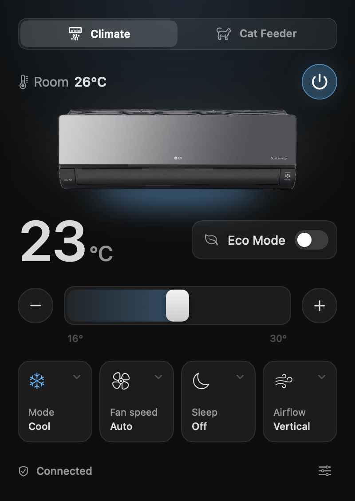
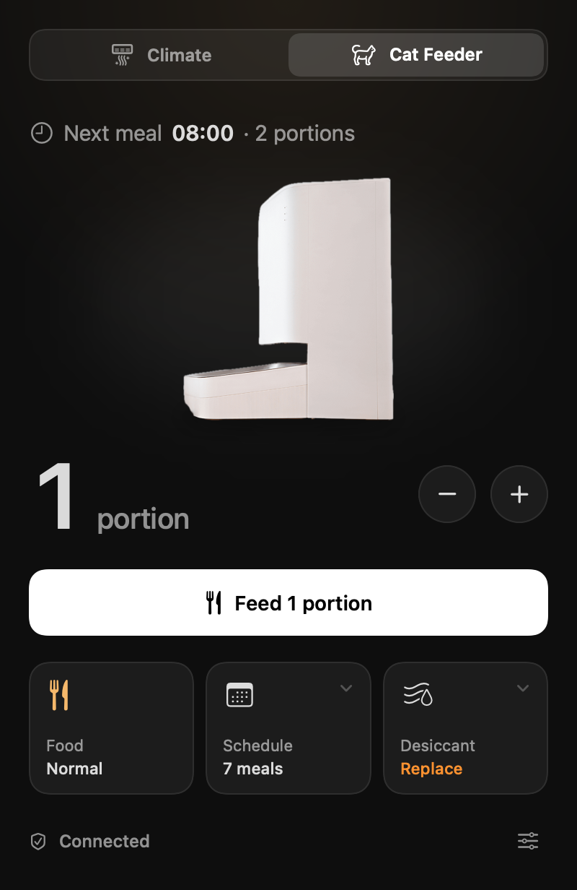
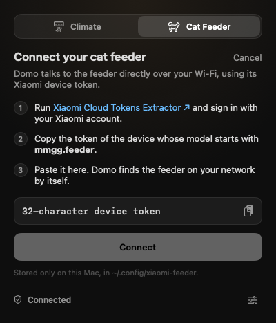

# Domo

A small macOS menu bar app for the smart things around the house.
Click the icon, change what you need, get back to work.

<p align="center">
  
  &nbsp;
  
  &nbsp;
  
</p>

## What it controls

| Accessory | Integration | Status |
| --- | --- | --- |
| Air conditioner | LG ThinQ (official ThinQ Connect API) | ✅ Working |
| Cat feeder | Xiaomi Smart Pet Food Feeder (local miIO, no cloud) | ✅ Working |
| Smart plugs | Meross (local HTTP) | Planned |
| Lights, curtains, door, cameras | — | Planned |

Switch between accessories with the tabs at the top of the panel.

### Air conditioner

- Power, target temperature (slider or −/+), Eco Mode
- Mode, fan speed, sleep timer and swing direction from native menus
- Room temperature, and the set temperature right in the menu bar
- Reads what your unit actually supports from LG's device profile: per-mode
  temperature ranges, 0.5° steps, the fan speeds it offers
- Changes apply instantly and roll back if LG rejects them; rapid −/+ taps
  are sent as one command

### Cat feeder

- Feed 1–10 portions on demand
- Next scheduled meal, the full schedule, and pausing it
- Food level, faults, and the desiccant countdown, with a reset for when you
  swap the pack
- Finds the feeder on your network by itself: no IP addresses to configure
- A feed is never retried automatically, so the cat can't get fed twice by
  accident

Supports the `mmgg.feeder.fi1` model.

### Motion

Deliberately quiet, following Emil Kowalski's animation rules: digits roll
when a number changes, the AC's vent glows in the mode's color while it runs,
kibble drops into the bowl when a feed is confirmed, buttons react on press,
and the tab indicator slides with a single clipped layer. With *Reduce
Motion* on, movement gives way to simple fades.

## Requirements

- macOS 26 or later
- Swift 6.2+ (Xcode 26 or later, or the matching Command Line Tools)

## Build and install

```bash
./build.sh
```

This builds a release binary, wraps it in `Domo.app`, signs it ad hoc and
installs it to `~/Applications`. Open it from there; it lives in the menu bar
(no Dock icon). *Open at Login* is in the settings menu at the bottom right.

The first time the cat feeder connects, macOS asks whether Domo may find
devices on your local network. Allow it, or the feeder can't be reached.

## Connecting LG ThinQ

1. Sign in at [connect-pat.lgthinq.com](https://connect-pat.lgthinq.com).
2. Add a new token with **view devices**, **view device status** and
   **device control** permissions.
3. Open Domo and paste the token. It's checked against LG before it's saved.

The region is currently fixed to Turkey (`x-country: TR`, EIC endpoint); see
`ThinQClient.swift` to change it.

## Connecting the cat feeder

1. Get the feeder's device token with
   [Xiaomi Cloud Tokens Extractor](https://github.com/PiotrMachowski/Xiaomi-cloud-tokens-extractor)
   (sign in with your Xiaomi account; the model starts with `mmgg.feeder`).
2. Open Domo's **Cat Feeder** tab and paste the 32-character token. Domo
   looks for a feeder on your network that the token unlocks before saving it.

Either token can be changed later from the settings menu → **Change Token…**.

## Privacy

- Tokens are stored only on your Mac, readable by your user alone:
  `~/.config/lg-thinq/token` and `~/.config/xiaomi-feeder/token`.
- Domo talks to LG's API for the AC and directly to the feeder on your local
  network. Nothing else: no analytics, no accounts.

## Project layout

```
Sources/Domo/
  App/                 Entry point, root panel, menu bar label, snapshot tooling
  Shared/              Theme, tiles, toggles, slider, token screen, panel footer
  Accessories/
    AirConditioner/    LG ThinQ client, state store, panel
    CatFeeder/         miIO protocol, state store, panel, illustration
Resources/             Images bundled into the app
```

Each accessory keeps its client, its state and its views in its own folder.
Adding one means a new folder, a case in `AccessoryKind`, and a line in
`RootPanel`.

### Previewing without the menu bar

```bash
~/Applications/Domo.app/Contents/MacOS/Domo --snapshot panel.png --swiftui --tab feeder
```

Renders the panel with demo data and quits. `--tab climate|feeder` picks the
accessory, `--off` shows the AC powered off, `--live` uses your real devices,
`--setup` shows the token screen (drop `--swiftui` for that one, since it
contains a native text field). `Domo --feeder-status` runs a read-only check
of the feeder from the command line.

## Credits

- Air conditioner control uses LG's official
  [ThinQ Connect API](https://smartsolution.developer.lge.com/en/apiManage/thinq_connect);
  request headers follow LG's
  [`thinqconnect`](https://github.com/thinq-connect/pythinqconnect) SDK (Apache-2.0).
- The air conditioner image is LG's product photo of the AC18BH, from
  [lg.com](https://www.lg.com/tr/klima/split-klima/ac18bh/). © LG Electronics.
- The cat feeder image is Xiaomi's product photo of the Smart Pet Food Feeder,
  from [mi.com](https://www.mi.com/global/product/xiaomi-smart-pet-food-feeder/). © Xiaomi.

Domo is a personal project and isn't affiliated with or endorsed by LG
Electronics or Xiaomi. LG and ThinQ are trademarks of LG Electronics; Xiaomi
is a trademark of Xiaomi Inc.

## License

The code is released under the [MIT License](LICENSE). Product photos are
the property of their manufacturers and aren't covered by it.
